<p align="center">
  
</p>

<h1 align="center">DS Desktop 🐳</h1>

<p align="center">
  一个随叫随到的 DeepSeek 桌面小窗 —— 不用切窗口，不用开浏览器，<br>
  按一下 <kbd>⌥</kbd><kbd>Space</kbd>，问题丢进去，答案流出来。
</p>

<p align="center">
  macOS · Apple 芯片 · 非官方客户端
</p>

<p align="center">
  <a href="LICENSE"></a>
</p>

<p align="center">
  
</p>

---

## 它是什么

DS Desktop 把 DeepSeek 网页版装进了 Mac 的快捷面板里。

它**不需要 API Key**，也不要求你另外注册账号 —— 登录你自己的 DeepSeek 账号就能用，
聊天记录仍然保存在 DeepSeek 那边，和网页版完全同步。

它有两个窗口：

- 🖥️ **主窗口**：完整的 DeepSeek 网页，适合长对话、看历史记录、翻代码
- ⚡ **快捷窗口**：一块随叫随走的小面板，专门对付「随手问一句」

平时你只需要记住快捷键。

---

## ⚡ 快捷窗口：把「问一句」的成本降到最低

### 一个键，它就出现 ⌥Space

不管你在写代码、看文档还是刷网页，按 <kbd>⌥</kbd><kbd>Space</kbd>，面板就浮到眼前。
不抢桌面、不切 App、不需要先找到浏览器标签页。

问完按 <kbd>Esc</kbd>，它消失，焦点自动还给你刚才在用的应用。

### 看着小，用起来完整 ✨

空面板只有一行输入框那么高，不挡视线。发出问题后，它会自然地向下让开、
从底边向上展开，消息再淡入 —— 整个过程不像弹窗，更像它本来就在那里。

面板里该有的都有：

- 回答**逐字流出**，和网页版一样
- 「深度思考」「智能搜索」开关随手切换
- 一键复制回答
- 顶栏「新对话」，问完一个话题直接开新的

### 它记得你上次把它放在哪 📍

拖到屏幕角落，下次唤出还在那里；没有挪过的话，就从屏幕正中出来。

**关掉再打开，对话也还在** —— 除非距离上次关闭已经超过你设置的时间
（默认 10 分钟），那才会以一个新对话开始。想接着问就接着问，不用重新组织语言。

### 需要认真看的时候，一键扩大

面板右上角的「扩大」会把这段对话原样带到主窗口 ——
同一个会话、同一条回答，不会让你重新问一遍。

反过来，主窗口里的任何对话，也可以随时用快捷键拉进快捷窗口继续。

### 启动就是它 🚀

- 第一次安装：先显示主窗口，登录完成后自动收起，换成快捷窗口
- 之后每次启动：如果你已经登录，**只出现快捷窗口**，不会看到主窗口一闪而过

未登录时快捷键不会响应 —— 面板背后没有可用的会话，唤出来也做不了事。

---

## 🎛 其他

- **深浅色**跟随系统，面板圆角、描边、配色都按 macOS 的习惯来
- **菜单栏常驻图标**：设置、显示主窗口、退出
- **呼出快捷键可改**：想换成自己的组合键，到设置里点一下重新录制
- **中英文界面**：跟随系统，也可以手动指定
- **退出登录**：清掉本机登录态，聊天记录不受影响

---

## 📦 安装

1. 从 [Releases](../../releases) 下载最新的 `.dmg`
2. 打开 dmg，把 `DS Desktop` 拖进「应用程序」
3. 首次启动：在「应用程序」里**右键 → 打开**，再点一次「打开」

> 这个应用没有做 Apple 开发者签名和公证，所以系统会拦一下。
> 如果提示「已损坏」，在终端执行一次：
>
> ```bash
> xattr -cr "/Applications/DS Desktop.app"
> ```

---

## ⌨️ 快捷键

| 操作 | 快捷键 |
|---|---|
| 呼出 / 收起快捷窗口 | <kbd>⌥</kbd><kbd>Space</kbd>（可自定义） |
| 收起快捷窗口 | <kbd>Esc</kbd> |
| 打开设置 | <kbd>⌘</kbd><kbd>,</kbd> |
| 复制回答 | 点击回答下方的复制按钮 |

> 💡 **小技巧**：把鼠标移到面板上，顶部功能栏会出现 —— 关闭、扩大、新对话都在那儿。
> 不看消息的时候它会自动让开，不占地方。

---

## 🔒 隐私

- 不接入任何第三方 API，也不经过作者的服务器 —— 你的请求直接发往 `chat.deepseek.com`
- **不保存你的账号密码**，登录态只存在本机，由 macOS 的应用沙盒和 Electron 会话负责
- 不读取、不上传、不备份你的聊天记录
- 没有任何埋点，也不收集任何统计信息

---

## 🧩 已知限制

- 只支持 **Apple 芯片**的 Mac
- 回答目前以**纯文本**显示，不渲染 Markdown（代码块、表格会原样呈现）
- 暂不支持附件、搜索替换等网页版的进阶功能
- DeepSeek 网页版如果大改版，可能需要跟着更新

---

## 📌 说明

本项目是个人开发的**非官方**客户端，与 DeepSeek 官方无关。

它的工作方式是驱动你自己登录的网页版 —— 不破解、不绕过登录，也不批量调用接口。
使用时仍需遵守 DeepSeek 的服务条款。

如果你觉得它好用，欢迎提 Issue 说一声；遇到 DeepSeek 改版导致的失效，也欢迎反馈。

---

## 📄 License

[MIT](LICENSE) © 2026 SalvinTang
